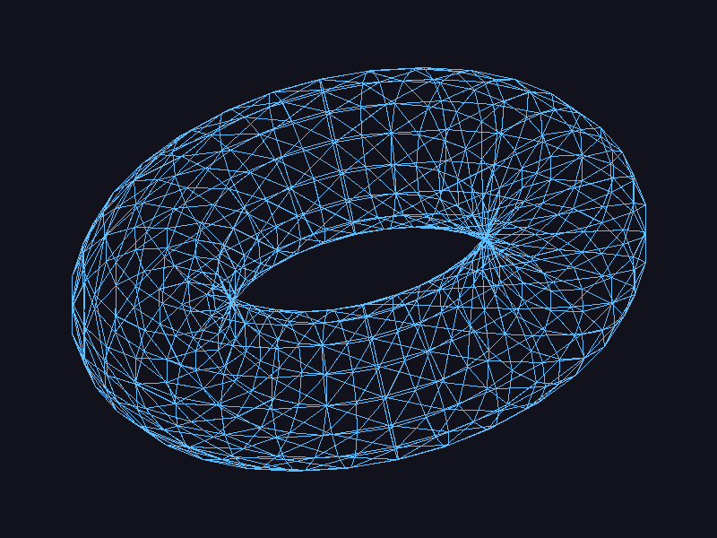

# OBJ Renderer

Renderer de software en Rust que carga un modelo `.obj` y lo dibuja triángulo por triángulo con una función `triangle` propia. Raylib se usa únicamente para abrir la ventana y mostrar el framebuffer; no se usan sus funciones para cargar ni dibujar modelos.

## Resultado



## Pipeline

```
Archivo OBJ
    ↓
Vértices + índices
    ↓
Triángulos
    ↓
Líneas
    ↓
Píxeles
    ↓
Pantalla
```

## Cómo funciona

1. `Model::load` lee el `.obj` y guarda los vértices (`v`) y los índices de las caras (`f`). Los índices del OBJ empiezan en 1, así que se les resta 1. Si una cara tiene más de 3 vértices, se triangula en abanico.
2. `fit_to_screen` usa solo las componentes `x` e `y` de cada vértice. Calcula el mínimo y el máximo del modelo, lo escala para que quepa en la ventana con un margen del 80 % y lo centra. También invierte `y`, porque en pantalla crece hacia abajo.
3. Por cada grupo de 3 índices se buscan los 3 vértices correspondientes y se llama a `triangle`.
4. `triangle` dibuja los tres bordes del triángulo con líneas (algoritmo de Bresenham).
5. Cada línea escribe píxeles en el framebuffer, que al final se muestra en la ventana.

Todavía no hay perspectiva ni transformaciones 3D. Es una proyección directa de `x` e `y`.

## Estructura

- `src/obj.rs`: cargador de OBJ (vértices e índices de caras, triangulación de polígonos).
- `src/triangle.rs`: función `triangle` (dibuja los tres bordes con líneas de Bresenham).
- `src/framebuffer.rs`: framebuffer con la función `point`.
- `src/main.rs`: escala y traslada el modelo al centro de la ventana y dibuja cada triángulo.
- `assets/torus.obj`: modelo utilizado (512 vértices, 1024 triángulos).
- `docs/render.png`: captura del resultado.

## Requisitos

- [Rust](https://www.rust-lang.org/tools/install) (cargo)
- El crate `raylib` compila la librería C de Raylib, por lo que puede requerir `cmake` y un compilador de C (en Windows, las Build Tools de Visual Studio o MinGW; en Linux, `build-essential` y `cmake`).

## Ejecución

```
cargo run --release
```

Para usar otro modelo:

```
cargo run --release -- ruta/al/modelo.obj
```

Para exportar una captura sin abrir la ventana:

```
cargo run --release -- --export
```

Esto genera `screenshot.png` en la raíz del proyecto.